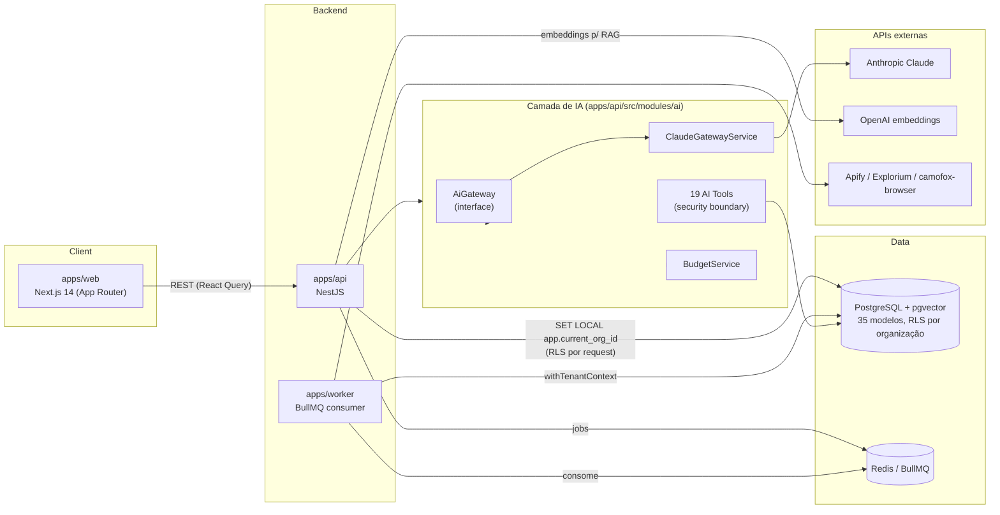

# OpsMind

**AI-Powered Business Operations Platform** — CRM, tarefas, documentos, financeiro, prospecção de leads e automações, com uma camada de IA (agente de tool-calling sobre Claude) que lê o contexto real do negócio e **age** sobre ele, não só responde perguntas.

> Your business data shouldn't just be stored. It should work for you.

[](https://github.com/ascef182/opsmind/actions/workflows/ci.yml)


---

## O que é isso

OpsMind é uma plataforma de operações de negócio (CRM + tasks + documentos + financeiro) construída do zero com uma arquitetura multi-tenant real, e uma camada de IA que não é um chatbot decorativo: é um **agente com acesso controlado a ferramentas de negócio reais** — consulta clientes, cria tarefas, move deals no pipeline, qualifica leads, gera rascunhos de outreach, lê documentos via RAG — tudo isso respeitando as mesmas regras de permissão e isolamento de tenant que um usuário humano teria.

Não é um boilerplate: é um monorepo com **20 módulos de domínio**, **35 modelos de dados**, **19 ferramentas de IA**, **138 specs automatizados** (unitários + e2e) e uma suíte de avaliação que roda contra as APIs reais da Anthropic/OpenAI em CI — não mocks — para medir acurácia de tool-calling, grounding de RAG, hallucination e resistência a prompt injection.

## Por que este projeto é diferente de um CRUD com IA por cima

A maior parte de "SaaS com IA" para portfólio é um chat preso num `fetch` para a API da OpenAI. Aqui, cada decisão de arquitetura resolveu um problema real de produto que aparece assim que o sistema precisa ser **multi-tenant** e **confiável**:

- **Isolamento de tenant em duas camadas independentes.** Toda tabela de negócio é filtrada por `organizationId` na aplicação *e* por Row-Level Security no Postgres — e a API nunca se conecta ao banco com um papel que ignora RLS. Um bug no filtro de uma query não vira vazamento de dados entre empresas: o Postgres recusa a linha de qualquer jeito. A mecânica inteira (interceptor → `AsyncLocalStorage` → proxy transparente do Prisma → guard) está documentada em [`CLAUDE.md`](CLAUDE.md#multi-tenancy-defense-in-depth-this-is-the-architecture-to-understand-first).
- **A IA nunca pode fazer mais do que o usuário que a invocou.** Nenhuma tool de IA aceita `organizationId`/`role` como campo controlável pelo modelo — esse contexto é sempre injetado pelo backend a partir da sessão autenticada, do mesmo jeito que os guards injetam para rotas normais. Documentos recuperados por RAG são tratados como **dado para citar**, nunca como instrução — o prompt de sistema explicitamente instrui o modelo a ignorar instruções embutidas em conteúdo de documento, e a suíte de eval tem uma categoria dedicada (`prompt-injection`) que testa isso contra documentos reais.
- **Avaliação de IA é CI, não vibe check.** `pnpm --filter api eval` sobe a aplicação Nest completa, registra usuário/org, semeia fixtures e roda o endpoint de chat contra **as APIs reais** da Anthropic e OpenAI (não mocks) em 4 categorias — tool-accuracy, rag-grounding, hallucination-judge, prompt-injection — gravando um relatório (`eval-report.json`). Isso roda como job próprio no GitHub Actions, pulado em PRs de fork que não recebem secrets.
- **Scoring de leads é determinístico por design, nunca IA em massa.** Rodar um modelo de linguagem sobre milhares de leads por job custaria budget sem controle. `scoreLead()` é uma função pura e compartilhada bit-a-bit entre o worker (scraping em lote) e a API (score sob demanda): fórmula de firmografia quando a fonte é estruturada, fallback por palavra-chave contra os sinais do catálogo de serviços quando não é. Uma análise de IA por lead existe, mas é sempre opt-in e grava em uma entidade separada — nunca muta o lead direto.
- **Aprovação de outreach é sempre humana — por construção, não por convenção.** A máquina de estados de uma mensagem de outreach (`DRAFT → APPROVED → SENT → REPLIED`) só avança via endpoint HTTP autenticado. Não existe, e não pode existir, uma tool de IA que aprove ou envie uma mensagem — a única tool de IA no fluxo gera o rascunho e para.
- **Fontes de dados plugáveis via registry, não if/else crescente.** Busca de leads roda contra Apify, Explorium ou um browser stealth self-hosted (camofox), escolhido pelo usuário por job. O worker despacha por um `Record<ScrapeSourceType, SourceHandler>` — adicionar uma fonte nova não toca no código de despacho.
- **Orçamento de IA por organização, aplicado antes da chamada, não depois do boleto.** Cada chamada de chat passa por um `BudgetService` que estima custo por tokens e bloqueia a requisição se a organização já estourou o teto mensal configurado.

## Arquitetura



**Três deployables, dois pacotes compartilhados:**

| Workspace | Papel |
|---|---|
| `apps/api` | NestJS — toda a lógica de negócio, REST, chat/tools de IA, plumbing de RLS por transação |
| `apps/web` | Next.js 14 (App Router) — cliente fino, React Query, zero lógica de negócio no servidor |
| `apps/worker` | Consumidor BullMQ — automações e scraping de leads, contexto de tenant próprio (sem `AsyncLocalStorage`, processa um job por vez) |
| `packages/database` | Schema Prisma (35 modelos) + client, migrations comentadas com o racional de cada decisão de schema |
| `packages/shared-types` | DTOs/enums compartilhados e funções de domínio puras (ex.: `scoreLead()`) que API e worker precisam concordar bit-a-bit |
| `packages/config` | Schema Zod de env (validado fail-fast no boot) + eslint/tsconfig compartilhados |
| `packages/integrations` | Gateways de API externa (Apify, Explorium, camofox-browser) usados por API e worker, que não podem se importar entre si |

## Funcionalidades

- **CRM** — clientes, pipeline de deals (com propostas geradas por IA), tarefas, notas internas, atividade, reuniões
- **Financeiro** — contratos, lançamentos recorrentes, pagamentos, relatórios
- **Prospecção de leads** — busca de negócios locais por cidade/estado/tipo via fontes plugáveis, qualificação (scoring híbrido), promoção a cliente, outreach assistido por IA com aprovação humana obrigatória, sinais de mercado e matching sinal↔oferta
- **Documentos + RAG** — upload, extração de PDF, chunking, embeddings (pgvector), busca semântica citável pela IA
- **Automações** — motor de automação orientado a fila (BullMQ), rodando no worker
- **Agente de IA** — chat com loop agentic manual (até 8 iterações), 19 tools de negócio, auditoria completa de requests/tool calls, orçamento mensal por organização
- **RBAC** — 5 papéis hierárquicos (`OWNER > ADMIN > MANAGER > MEMBER > VIEWER`), guards dedicados para atribuição de papel

## Stack

| Camada | Tecnologia |
|---|---|
| Frontend | Next.js 14 (App Router), React 18, TanStack Query, Radix UI, Tailwind, Recharts |
| Backend | NestJS 10, Prisma, class-validator, Passport/JWT, argon2 |
| IA | `@anthropic-ai/sdk` (agente de tool-calling), OpenAI (embeddings) |
| Dados | PostgreSQL 16 + pgvector, Redis + BullMQ |
| Observabilidade | Sentry (`@sentry/nestjs`), `nestjs-pino` (logs estruturados) |
| Infra / DX | pnpm + Turborepo, Docker Compose, Jest, GitHub Actions |

## Qualidade e testes

- **126 specs unitários** + **12 specs e2e** (Jest), rodando em paralelo via Turborepo
- **Suíte de avaliação de IA** contra APIs reais (não mockada), 4 categorias: tool-accuracy, rag-grounding, hallucination-judge, prompt-injection — job dedicado em CI
- **CI** reproduz o bring-up exato contra um Postgres limpo: `prisma generate` → extensão `pgvector` → `migrate deploy` → criação do papel restrito de RLS → lint → typecheck → test → test:e2e
- **Lint + typecheck** fan-out por workspace via Turborepo, com cache de build

## Começando

```bash
pnpm install
docker compose -f infra/docker/docker-compose.yml up -d   # Postgres (pgvector) + Redis
cp .env.example .env                                        # ajuste os segredos
pnpm db:migrate                                              # prisma migrate dev
pnpm dev                                                      # web:3001, api:3000
```

`GET http://localhost:3000/health` deve responder `200 OK` quando a API e o banco estiverem de pé.

```bash
pnpm build / pnpm lint / pnpm typecheck / pnpm test   # fan-out via Turborepo
pnpm test:e2e                                          # precisa de Postgres+Redis up
pnpm --filter api eval                                 # suíte de avaliação de IA (APIs reais)
```

Escopo em um workspace: `pnpm --filter <nome> run <script>` — pacotes: `@opsmind/api`, `@opsmind/web`, `@opsmind/worker`, `@opsmind/database`, `@opsmind/shared-types`, `@opsmind/config`.

## Estrutura

```
apps/
  web/        Next.js — React Query hooks em lib/<domínio>/use-*.ts
  api/        NestJS — módulos de domínio, AI tools, RLS/tenant plumbing
  worker/     BullMQ — automações e scraping de leads
packages/
  database/      Prisma schema (35 modelos) + client gerado
  shared-types/  DTOs/enums e funções de domínio puras compartilhadas
  config/        Zod env schema + eslint/tsconfig
  integrations/  Gateways externos (Apify, Explorium, camofox-browser)
infra/
  docker/     docker-compose local + scripts de init (extensão pgvector, papel de RLS)
docs/
  planning/   PRD, decisões de arquitetura por fase, pareceres de revisão especializada
```

## Documentação de arquitetura

- [`CLAUDE.md`](CLAUDE.md) — guia de arquitetura completo: multi-tenancy em defesa profunda, módulo de IA, RAG, módulo de leads, RBAC, convenções de comando
- [`docs/planning/PRD.md`](docs/planning/PRD.md) — PRD e arquitetura técnica completa
- [`docs/planning/sprint-1-2-plan.md`](docs/planning/sprint-1-2-plan.md) — log de decisões da Fase 1/2, com o racional de escolhas não óbvias

---

Construído como projeto de engenharia full-stack + IA aplicada — da modelagem de dados multi-tenant ao agente de produção com guard-rails de segurança e avaliação contínua.
